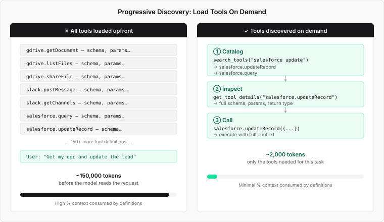
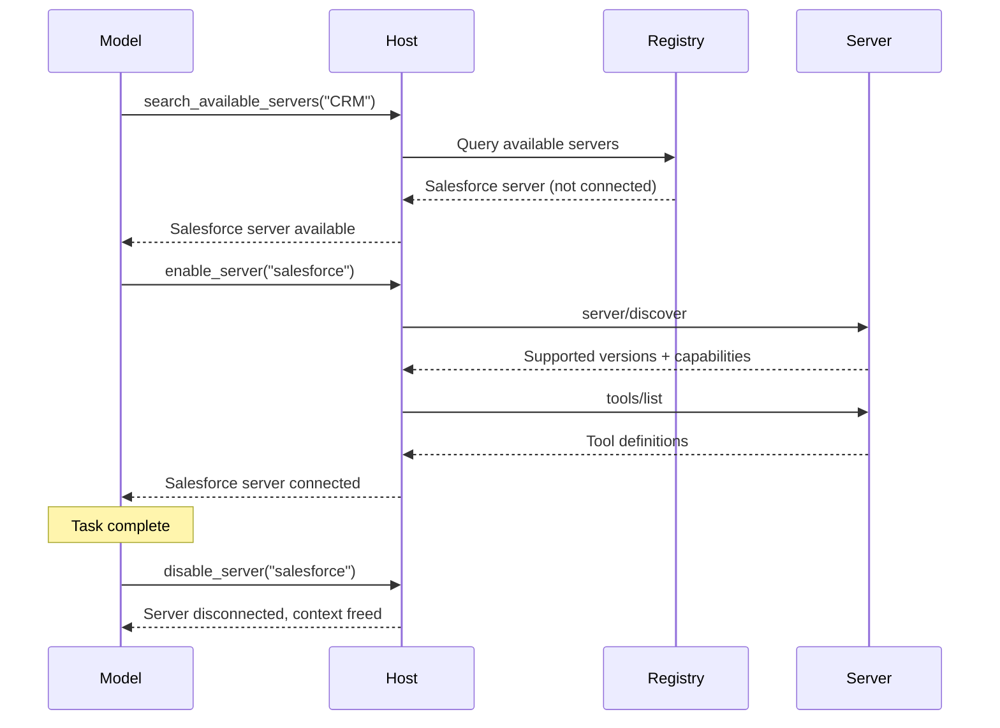
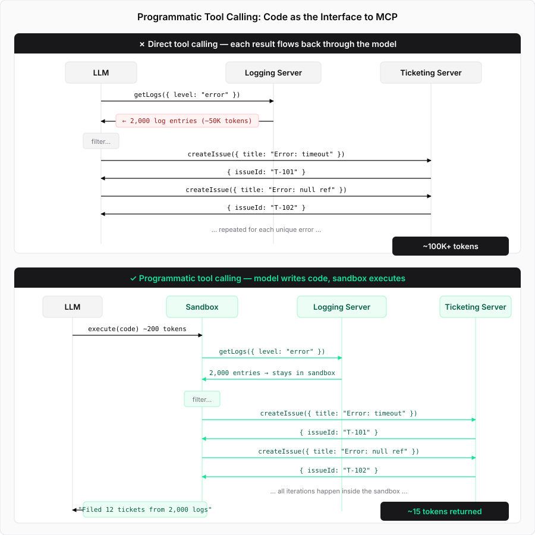
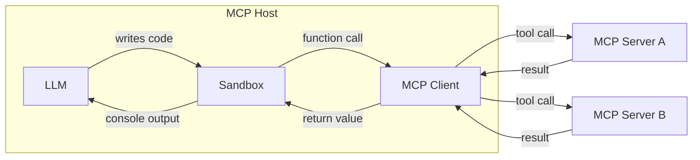

<Info>
  本页是社区维护的**非官方**中文译文，不代表 MCP 官方。原文：Model Context Protocol 项目的[英文页面](https://modelcontextprotocol.io/docs/2026-07-28/develop/clients/client-best-practices)（上游提交 `b488c166`），© Model Context Protocol a Series of LF Projects, LLC.，按 [CC-BY-4.0](https://creativecommons.org/licenses/by/4.0/) 授权。本页由原文翻译成中文，并按同一许可发布。如有出入，以英文原文为准。
</Info>

随着 MCP 宿主应用（比如智能体）接入的 MCP 服务器越来越多，能用的工具累积到成百上千个，简单粗暴的工具管理方式就撑不住了。一开始就把所有工具定义塞进模型的上下文窗口，既浪费 token，又增加延迟，还会降低模型表现。连续调用工具时，如果大块的中间结果都要从模型那里过一遍，问题就更严重。

有两种模式可以应对这些问题：**渐进式发现**，控制工具定义*何时*进入上下文；**程序化工具调用**，控制工具*如何*被调用。

<a id="progressive-tool-discovery" />
## 渐进式工具发现

简单的 MCP 宿主实现会在每次对话开始时，把所有已连接服务器的工具定义直接交给模型。工具只有几个的时候，这么做完全没问题。但如果宿主接入了几十个服务器、暴露出几百个工具，光是这些定义就可能在模型读到用户消息之前占掉大半个上下文窗口。



渐进式发现可以避免这种情况：

- 宿主照常通过 `tools/list` 获取工具定义，但先不把它们注入模型的上下文。
- 宿主给模型提供一个轻量的 `search_tools` 元工具。
- 宿主只在需要时才把完整定义加载进上下文。

<a id="when-to-use-progressive-discovery" />
### 什么时候用渐进式发现

渐进式发现最适合工具定义占用大量上下文窗口的情况。如果工具不多，定义只占上下文窗口的一小部分，全部加载也没问题。一旦工具定义占去了可用上下文窗口的相当一部分，客户端就应该切换到渐进式发现。我们建议客户端设置阈值来决定何时切换：

- 把阈值设为上下文窗口的一个百分比，例如 1%–5%。
- 先加载工具定义，达到阈值后就切换到渐进式发现。

<a id="choosing-a-discovery-strategy" />
### 选择发现策略

模型调用 `search_tools` 工具之后，需要选定一种搜索策略：

- **基于关键词**：关键词匹配（BM25、正则表达式）。简单有效，工具名称和描述写得清楚时效果尤其好。
- **基于嵌入向量**：在工具描述上做向量相似度检索。更擅长处理同义词和语义匹配。
- **基于子智能体**：由另一个模型（通常是 Claude Haiku 或 Gemini Flash 这类又小又快的模型）为任务挑选工具。效果通常很好，但成本可能比基于嵌入向量或关键词的方案高。
- **混合**：把几种方法组合起来。比如综合关键词排名和嵌入向量排名来打分，或者按使用场景、查询内容选用不同策略。

一些模型提供商已经内置了工具搜索。例如 [OpenAI](https://developers.openai.com/api/docs/guides/tools-tool-search) 和 [Anthropic](https://platform.claude.com/docs/en/agents-and-tools/tool-use/tool-search-tool) 都原生支持；可以查一下你所用提供商的文档，看有没有类似功能。如果有，可以优先用平台自带的工具搜索，而不是自己实现。提供商没有这项功能，或者你需要特殊的检索逻辑（比如针对特定领域的排序，或按访问权限过滤）时，再自己构建。

下面的三层模式详细演示了一种基于搜索的自定义做法，不过这种分层思路（目录、查看、执行）不管用哪种检索机制都适用。

<a id="using-progressive-discovery" />
### 使用渐进式发现

渐进式发现的一种常见实现，是基于搜索的三层做法：

**第 1 层：目录**。宿主暴露一小组元工具，用来搜索可用的能力。`search_tools` 工具接受一条自然语言查询，返回匹配的工具名称和简短描述。

```typescript
// The model calls a lightweight search tool
search_tools({ query: "update salesforce record" })

// Returns concise matches: names and one-line descriptions only
→ [
    { name: "salesforce_updateRecord", description: "Update fields on a Salesforce object" },
    { name: "salesforce_upsertRecord", description: "Insert or update based on external ID" }
  ]
```

**第 2 层：查看**。模型找到候选工具后，只获取这一个工具的完整定义（输入 schema、输出 schema、文档）。

```typescript
// The model inspects only the tool it needs
get_tool_details({ name: "salesforce_updateRecord" });
```

这一步返回单个工具的完整 schema：

```json
{
  "name": "salesforce_updateRecord",
  "description": "Updates a record in Salesforce",
  "inputSchema": {
    "type": "object",
    "properties": {
      "objectType": {
        "type": "string",
        "description": "Salesforce object type"
      },
      "recordId": { "type": "string", "description": "Record ID to update" },
      "data": { "type": "object", "description": "Fields to update" }
    },
    "required": ["objectType", "recordId", "data"]
  }
}
```

**第 3 层：执行**。模型只加载了它需要的定义，在完全了解接口的情况下调用工具。

这种模式能大幅减少 token 用量，还可能提高选工具的准确率：模型只需关注少数几个相关工具，不用在几百个无关工具里翻找。其他发现策略（嵌入向量、子智能体等）遵循同样的分层思路，只是在目录层换用不同的检索机制。

<a id="dynamic-server-management" />
### 动态管理服务器

渐进式发现不只适用于单个工具，也可以扩展到整个服务器。宿主不必在启动时连接所有配置好的服务器，而是可以：

1. 维护一份可用服务器的登记表，附上每个服务器的概要描述。
2. 只在模型判断需要某个服务器的能力时，才连接它。
3. 断开与当前任务不再相关的服务器，腾出上下文。



这对通用智能体尤其有效，因为事先并不知道用户想做什么。智能体启动时只连一小组常驻服务器，其他的按需连接。结合 [Agent Skills](/docs/2026-07-28/develop/build-with-agent-skills)，技能文件可以声明自己需要哪些 MCP 服务器，宿主只在调用该技能时才去连接它们。

<a id="implementation-guidelines" />
### 实现建议

实现渐进式发现时：

| 建议 | 理由 |
| --- | --- |
| **提供多种详细程度** | 让模型在只返回名称、返回名称和描述、返回完整 schema 之间选择。 |
| **缓存工具定义** | 从服务器取到定义后，在宿主端缓存起来，之后再注入时就不必再走一次 `tools/list`。这份缓存和模型上下文里当前有什么是两回事。 |
| **收到 `list_changed` 时刷新** | 服务器发出 `notifications/tools/list_changed` 时，重建搜索目录的索引。 |
| **按服务器分组展示工具** | 按来源服务器组织工具，方便模型理解哪些能力是相关的。 |

<a id="caching" />
### 缓存

每个列表结果（比如 `tools/list`），以及每个 `server/discover` 和 `resources/read` 的结果，都带有 `ttlMs` 和 `cacheScope` 提示。请按规范中[缓存工具](/specification/2026-07-28/server/utilities/caching)的定义遵循它们。特别是，一旦收到 `list_changed` 通知，就要把缓存的列表视为过期，即使 TTL 还没到。

<a id="interaction-with-prompt-caching" />
### 与提示词缓存的相互影响

大多数提供商会缓存提示词前缀，其中包括 `tools` 数组。在对话中途增删工具定义会让这份缓存失效，缓存未命中多花的 token，可能比你删掉的那些定义还多。为了保住缓存：

- 把新发现的定义追加在缓存断点之后，不要重新排序 `tools` 数组；或者让所有调用都经过一个固定不变的 `call_tool({name, args})` 元工具，这样数组就永远不会变。
- 把断开服务器当作对话边界上的操作，而不是每一轮都可能做的操作。
- 除了上面的工具搜索链接，也参考你所用提供商的缓存文档。

<a id="programmatic-tool-calling--code-mode" />
## 程序化工具调用 / 代码模式

直接调用工具时，每次调用都是一次往返：模型生成工具调用，客户端执行，完整结果再流回模型的上下文。如果任务需要串联多个工具（读一份文档、转换它、再写到别处），每个中间结果都要经过模型，即使模型根本不需要处理它们，也会消耗 token、增加延迟。

程序化工具调用（有时也叫「代码模式」）让客户端可以高效地**组合工具调用**。模型不直接调用工具，而是编写调用工具的代码。代码在沙箱环境中执行，只有最终结果返回给模型。

程序化工具调用很强大，能更高效地使用 MCP 工具和资源，但需要客户端实现沙箱环境。



<a id="how-it-works" />
### 工作原理

宿主把 MCP 工具的 schema 转换成沙箱内可用的带类型 API。模型需要用工具时，就写一段脚本并执行。

**第 1 步：根据 MCP schema 生成编程 API**。宿主读取每个服务器的工具定义，按每个工具的参数和 `outputSchema` 生成带类型的函数：

```typescript
// Auto-generated from the Logging MCP server's tool schema
interface LogEntry {
  timestamp: string;
  message: string;
  level: string;
}

function logging_getLogs(input: {
  level: "error" | "warn" | "info";
  since: number;
}): Promise<{ entries: LogEntry[] }> {
  return mcp.callTool<{ entries: LogEntry[] }>("logging_getLogs", input);
}

// Auto-generated from the Ticketing MCP server's tool schema
function ticketing_createIssue(input: {
  title: string;
  body?: string;
  priority: "low" | "medium" | "high";
}): Promise<{ issueId: string }> {
  return mcp.callTool<{ issueId: string }>("ticketing_createIssue", input);
}
```

MCP 服务器可以为每个工具提供一个可选的 [`outputSchema`](/specification/2026-07-28/server/tools#output-schema)。有输出 schema 时，宿主可以生成精确的返回类型（比如上面的 `LogEntry`）。

没有输出 schema 时，优先选简单的做法：

- **用通用类型，先往下走**。接受 `any` 或 `string`，在下游处理非结构化的输出。真正的解决办法是让服务器作者提供 `outputSchema`。
- **用快速模型提取带类型的结果**，适用于循环之外的单次调用。通过和 MCP 工具调用相同的桩函数拦截路径，暴露一个由宿主中转的 `extract(value, ExpectedType)` 辅助函数，这样沙箱自己始终不会建立网络连接。这个辅助函数会交给一个小模型（例如 Claude Haiku 或 Gemini Flash），把值转换成 `ExpectedType`。这会给每次调用增加延迟，而且模型可能编造或漏掉字段，所以使用前要按 `ExpectedType` 校验结果。

**第 2 步：模型基于这些 API 写代码**。模型不再分别调用各个工具、让完整结果在调用之间流经上下文，而是写一段脚本。以「找出过去一小时的所有错误日志，并为每种不同的错误建一个工单」这样的任务为例。直接调用工具的话，成千上万条日志都会流经模型的上下文；用代码的话，模型在沙箱里就完成了过滤：

```typescript
// Model-generated code, executes in sandbox
const logs = await logging_getLogs({
  level: "error",
  since: Date.now() - 3600000,
});

// Filter and deduplicate inside the sandbox, not in the model's context
const uniqueErrors = new Map<string, LogEntry>();
for (const log of logs.entries) {
  if (!uniqueErrors.has(log.message)) {
    uniqueErrors.set(log.message, log);
  }
}

for (const [message, log] of uniqueErrors) {
  await ticketing_createIssue({
    title: `Error: ${message}`,
    body: `First seen: ${log.timestamp}\nOccurrences: ${
      logs.entries.filter((l) => l.message === message).length
    }`,
    priority: "high",
  });
}

console.log(
  `Filed ${uniqueErrors.size} tickets from ${logs.entries.length} error logs`,
);
```

**第 3 步：沙箱执行代码**。沙箱内的函数调用会被拦截，经宿主中转转发给对应的 MCP 服务器。日志数据和工单创建直接在服务器之间流转，从不进入模型的上下文。返回给模型的只有 `console.log` 的输出，也就是一行摘要。

<a id="choosing-a-sandbox" />
### 选择沙箱

选哪种沙箱，取决于你想让模型写什么语言、宿主应用用什么语言，以及需要多强的隔离。下表列出的运行时只是示例，不代表推荐；请结合你的使用场景评估其成熟度：

| 沙箱内语言 | 运行时 / 库 | 宿主语言 | 做法 |
| --- | --- | --- | --- |
| **JavaScript** | [Deno](https://github.com/denoland/deno)、`isolated-vm` | Rust / Node / CLI | 基于 V8 的运行时，权限控制粒度细。可以关闭全部权限，彻底锁死。 |
| **Python** | [Monty](https://github.com/pydantic/monty) *（实验性）* | Rust | 专为 AI 场景打造的精简 Python 解释器。默认没有 I/O。 |
| **TypeScript** | [pctx](https://github.com/portofcontext/pctx) *（早期阶段）* | Python / Rust | 以库的形式实现代码模式的思路，底层有 Rust 支持。 |
| **任意语言（借助 Wasm）** | [Wasmtime](https://github.com/bytecodealliance/wasmtime) | Rust / C / Go | 把任意语言编译成 Wasm，在基于能力的安全模型下运行。 |

不管用哪种沙箱，集成方式都一样：宿主注入桩函数，通过进程内或 stdio 通道拦截调用（这样网络权限可以完全关闭），再把它们作为 `tools/call` 请求分发给 MCP 服务器。

<a id="execution-architecture" />
### 执行架构

这套实现由三部分组成：



**沙箱**在隔离环境中运行模型生成的代码，不能直接访问网络。它与外界唯一的接口是生成的桩函数，这些桩函数把调用转回宿主。

**宿主**充当中转方。它接收沙箱发来的函数调用，对应到正确的 MCP 服务器，执行工具调用，再把结果返回沙箱。授权令牌和凭据由宿主保管，从不暴露给生成的代码。

**模型**只看到沙箱返回的内容，通常是 `console.log` 语句的输出或最终的返回值。这样模型（以及客户端开发者）就能精确控制哪些内容进入上下文窗口。

<a id="security-considerations" />
### 安全考虑

程序化工具调用引入了代码执行这一攻击面，需要认真做好沙箱隔离：

- **逐次授权**：按规范来说，中转方仍然是 MCP 宿主。对沙箱发起的调用，要采用和直接调用相同的人工确认策略（参见[工具：安全](/specification/2026-07-28/server/tools#security-considerations)）。批准了脚本，并不等于批准它运行时发出的每一次工具调用；宿主可以按类别授权（例如「本次脚本运行允许调用 `ticketing_createIssue`」），不必每次循环都询问，但中转方仍必须逐次对照这项授权检查每个调用。
- **跨服务器的数据流**：一个服务器返回的工具结果，对另一个服务器来说是不可信的输入。中转方对经它中转的调用，应采用和直接调用相同的输入审查策略；单靠截断输出防不住数据外泄。
- **网络隔离**：沙箱不应能直接访问网络。所有对外通信都经过宿主中转，由它执行授权和访问控制。
- **不暴露凭据**：API 密钥和令牌由宿主保管。生成的代码只调用带类型的函数，宿主在转发给服务器时再加上认证信息。
- **资源限制**：给沙箱执行设置超时和内存上限，防止脚本失控。
- **输出过滤**：沙箱的控制台输出在交回模型之前，要先校验并截断。

<a id="error-handling" />
### 错误处理

MCP 工具出错时，返回的是一个带 [`isError: true`](/specification/2026-07-28/server/tools#error-handling) 的成功响应，而不是传输层失败。生成的包装函数应把它转换成抛出的异常，好让模型写的代码能用 `try`/`catch` 处理。如果未捕获的错误让脚本中止，应把它作为脚本的结果交给模型，让模型自行纠正；已经产生的部分副作用，由模型负责报告。

<a id="combining-both-patterns" />
## 两种模式结合使用

渐进式发现和程序化工具调用可以很好地配合。模型先用发现工具找出需要哪些工具，加载它们的 schema，再写一段脚本，在一次执行中调用多个工具。两者结合，工具定义的 token 开销*和*工具结果的 token 开销都能降到最低，让模型的上下文专注于推理，而不是充当数据的中转站。
