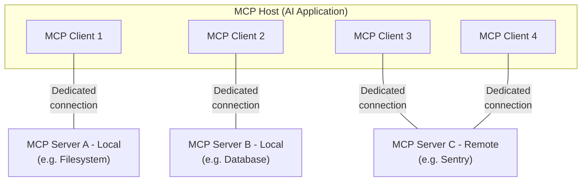

<Info>
  本页是社区维护的**非官方**中文译文，不代表 MCP 官方。原文：Model Context Protocol 项目的[英文页面](https://modelcontextprotocol.io/docs/2026-07-28/learn/architecture)（上游提交 `ac00313f`），© Model Context Protocol a Series of LF Projects, LLC.，按 [CC-BY-4.0](https://creativecommons.org/licenses/by/4.0/) 授权。本页由原文翻译成中文，并按同一许可发布。如有出入，以英文原文为准。
</Info>

本文概述 Model Context Protocol（MCP）的[范围](#scope)和[核心概念](#concepts-of-mcp)，并通过一个[示例](#example)逐一演示这些核心概念。

MCP SDK 已经替你处理了许多细节，因此对大多数开发者来说，最有用的可能是[数据层协议](#data-layer-protocol)一节。它介绍了 MCP 服务器如何向 AI 应用提供上下文。

具体的实现细节，请参阅你所用语言的 [SDK](/docs/2026-07-28/sdk) 文档。

<a id="scope" />
## 范围

Model Context Protocol 包括以下几个项目：

- [MCP 规范](https://modelcontextprotocol.io/specification/latest)：MCP 的规范文档，规定了客户端和服务器的实现要求。
- [MCP SDK](/docs/2026-07-28/sdk)：用不同编程语言实现 MCP 的 SDK。
- **MCP 开发工具**：用于开发 MCP 服务器和客户端的工具，包括 [MCP Inspector](https://github.com/modelcontextprotocol/inspector)
- [MCP 参考服务器实现](https://github.com/modelcontextprotocol/servers)：MCP 服务器的参考实现。

<Note>
  MCP 只关注上下文交换的协议本身，并不规定 AI 应用如何使用 LLM，也不规定如何管理所提供的上下文。
</Note>

<a id="concepts-of-mcp" />
## MCP 的概念

<a id="participants" />
### 参与者

MCP 采用客户端-服务器架构：MCP 宿主（Host），即 [Claude Code](https://www.anthropic.com/claude-code) 或 [Claude Desktop](https://www.claude.ai/download) 这样的 AI 应用，与一个或多个 MCP 服务器建立连接。具体做法是，MCP 宿主为每个 MCP 服务器各创建一个 MCP 客户端，每个 MCP 客户端与对应的 MCP 服务器保持一条专用连接。

使用 STDIO 传输的本地 MCP 服务器通常只服务一个 MCP 客户端；而使用 Streamable HTTP 传输的远程 MCP 服务器通常会同时服务许多 MCP 客户端。

MCP 架构中的主要参与者有：

- **MCP 宿主**：协调和管理一个或多个 MCP 客户端的 AI 应用
- **MCP 客户端**：一个组件，负责与某个 MCP 服务器保持连接，并从该服务器获取上下文供 MCP 宿主使用
- **MCP 服务器**：向 MCP 客户端提供上下文的程序

**举个例子**：Visual Studio Code 就是一个 MCP 宿主。当 Visual Studio Code 连接到某个 MCP 服务器（例如 [Sentry MCP 服务器](https://docs.sentry.io/product/sentry-mcp/)）时，Visual Studio Code 运行时会实例化一个 MCP 客户端对象，由它维持与 Sentry MCP 服务器的连接。
之后 Visual Studio Code 再连接另一个 MCP 服务器（例如[本地文件系统服务器](https://github.com/modelcontextprotocol/servers/tree/main/src/filesystem)）时，Visual Studio Code 运行时会再实例化一个 MCP 客户端对象来维持这条连接。



注意，**MCP 服务器**指的是提供上下文数据的程序，与它运行在哪里无关。MCP 服务器既可以在本地运行，也可以在远程运行。例如，Claude Desktop 启动[文件系统服务器](https://github.com/modelcontextprotocol/servers/tree/main/src/filesystem)时，这个服务器使用 STDIO 传输，因此运行在同一台机器上，这通常称为"本地" MCP 服务器。官方的 [Sentry MCP 服务器](https://docs.sentry.io/product/sentry-mcp/)运行在 Sentry 平台上，使用 Streamable HTTP 传输，这通常称为"远程" MCP 服务器。

<a id="layers" />
### 分层

MCP 由两层组成：

- **数据层**：定义基于 JSON-RPC 的客户端-服务器通信协议，包括能力与版本的发现，以及工具、资源、提示词模板和通知等核心原语。
- **传输层**：定义客户端与服务器之间交换数据所用的通信机制和通道，包括各传输方式特有的连接建立、消息分帧和授权。

从概念上说，数据层是内层，传输层是外层。

<a id="data-layer" />
#### 数据层

数据层实现了一套基于 [JSON-RPC 2.0](https://www.jsonrpc.org/) 的交换协议，定义了消息的结构和语义。
这一层包括：

- **发现**：客户端可以通过 `server/discover` 请求，查询服务器支持的协议版本、能力和身份信息
- **服务器功能**：让服务器提供核心功能，包括供 AI 执行操作的工具、提供上下文数据的资源，以及用于客户端交互的提示词模板
- **客户端功能**：让服务器能够向用户征询输入。
- **辅助功能**：支持其他附加能力，例如实时更新通知、长时间运行操作的进度跟踪

<a id="transport-layer" />
#### 传输层

传输层负责客户端与服务器之间的通信通道和身份认证，处理 MCP 参与者之间的连接建立、消息分帧和安全通信。

MCP 支持两种传输机制：

- **Stdio 传输**：通过标准输入/输出流，在同一台机器上的本地进程之间直接通信。没有网络开销，性能最好。
- **Streamable HTTP 传输**：客户端发往服务器的消息使用 HTTP POST，并可选用 Server-Sent Events 实现流式传输。这种传输方式支持与远程服务器通信，也支持标准的 HTTP 认证方式，包括 bearer 令牌、API 密钥和自定义请求头。MCP 推荐使用 OAuth 获取认证令牌。

传输层把通信细节与协议层隔离开来，使所有传输机制都能使用同一种 JSON-RPC 2.0 消息格式。

<a id="data-layer-protocol" />
### 数据层协议

MCP 的核心之一，是定义 MCP 客户端与 MCP 服务器之间的数据模式和语义。开发者最感兴趣的可能就是数据层，尤其是其中的[原语](#primitives)。正是这一部分规定了开发者可以通过哪些方式，把上下文从 MCP 服务器共享给 MCP 客户端。

MCP 以 [JSON-RPC 2.0](https://www.jsonrpc.org/) 作为底层的 RPC 协议。客户端发送请求，服务器作出响应。服务器可以通过[多轮往返请求](/specification/2026-07-28/basic/patterns/mrtr)模式向客户端索取输入。不需要响应时，可以使用通知。

<a id="statelessness-and-discovery" />
#### 无状态与发现

MCP 是一种<Tooltip tip="每个请求都包含处理它所需的全部信息，因此服务器不会从之前的请求中推断任何东西">无状态协议</Tooltip>。每个请求都在 `_meta` 字段中携带协议版本，以及与该请求相关的<Tooltip tip="客户端或服务器支持的功能和操作，例如工具、资源或提示词模板">能力</Tooltip>，因此服务器可以独立处理每一个请求。除非另有配置，客户端还应在同一字段中标明自己的身份。服务器通过必须实现的 [`server/discover`](/specification/2026-07-28/server/discover) 请求声明自己支持的版本和能力，客户端可以在发送其他请求之前先发这个请求。详细信息见[规范](/specification/2026-07-28/basic/index#statelessness)，[示例](#example)中也演示了每个请求附带的元数据和发现流程。

<a id="primitives" />
#### 原语

原语是 MCP 中最重要的概念，它定义了客户端和服务器可以相互提供什么：可以与 AI 应用共享哪些类型的上下文信息，以及可以执行哪些操作。

MCP 定义了三种可由*服务器*暴露的核心原语：

- **工具**：AI 应用可以调用来执行操作的可执行函数（例如文件操作、API 调用、数据库查询）
- **资源**：为 AI 应用提供上下文信息的数据源（例如文件内容、数据库记录、API 响应）
- **提示词模板**：帮助组织与语言模型交互的可复用模板（例如系统提示词、少样本示例）

每种原语都有对应的方法：用于发现的（`*/list`），以及用于获取（`resources/read`、`prompts/get`）或执行（`tools/call`）的。
MCP 客户端用 `*/list` 方法发现可用的原语。例如，客户端可以先列出可用的工具（`tools/list`），把它们提供给模型，再执行模型调用的那些工具（`tools/call`）。这样的设计让列表可以是动态的。

举一个具体的例子：假设有一个提供数据库相关上下文的 MCP 服务器。它可以暴露用于查询数据库的工具、一个包含数据库模式（schema）的资源，以及一个包含少样本示例、指导如何使用这些工具的提示词模板。

关于服务器原语的更多细节，请参阅[服务器概念](/zh/docs/2026-07-28/learn/server-concepts)。

MCP 还定义了可由*客户端*暴露的原语，让 MCP 服务器的作者能够构建更丰富的交互。

- **征询（Elicitation）**：允许服务器向用户请求更多信息。当服务器作者需要从用户那里获取更多信息，或需要用户确认某个操作时，这一原语很有用。服务器通过 `elicitation/create` 方法请求用户输入。

征询请求通过[多轮往返请求](/specification/2026-07-28/basic/patterns/mrtr)模式传递，详见[征询概述](/zh/docs/2026-07-28/learn/client-concepts#elicitation)。

关于客户端原语的更多细节，请参阅[客户端概念](/zh/docs/2026-07-28/learn/client-concepts)。

自协议版本 `2026-07-28` 起，客户端功能中的根目录（roots）和采样（sampling），以及服务器功能中的协议日志，均已[弃用](/specification/2026-07-28/deprecated)。新的实现应改用以下替代方案：

- **根目录**：通过工具参数、资源 URI 或服务器配置传入目录或文件。
- **采样**：直接对接 LLM 提供商的 API。协议没有为"通过客户端请求模型生成"定义替代机制。
- **日志**：stdio 服务器[输出到 `stderr`](/docs/2026-07-28/tools/debugging#implementing-logging)，或使用 [OpenTelemetry](https://opentelemetry.io/)。

除了服务器原语和客户端原语，协议还支持构建在核心协议之上的可选[扩展](/extensions/overview)。例如，[任务（Tasks）扩展](/extensions/tasks/overview)允许服务器为长时间运行的请求返回一个持久的句柄，客户端可以据此轮询状态，并在之后获取结果。

<a id="notifications" />
#### 通知

协议支持实时通知，让服务器和客户端之间可以动态更新。例如，当服务器的可用工具发生变化（比如有新功能可用，或现有工具被修改）时，服务器可以发送工具更新通知，告知已连接的客户端。通知以 JSON-RPC 2.0 通知消息的形式发送（不期待响应）。变更通知需要主动订阅：客户端打开一个长期存在的 [`subscriptions/listen`](/specification/2026-07-28/basic/patterns/subscriptions) 流，列出想接收的通知类型，服务器就在这个流上推送匹配的通知。

<a id="example" />
## 示例

<a id="data-layer-1" />
### 数据层

本节以数据层协议为重点，一步步演示 MCP 客户端与服务器的交互过程。我们会用 JSON-RPC 2.0 消息演示发现、工具操作和通知。

<Steps>
<Step title="发现">

如[无状态与发现](#statelessness-and-discovery)一节所述，每个 MCP 请求都在 `_meta` 字段中携带协议版本和客户端能力，客户端还应在其中附上自己的身份。如果客户端想在发出其他请求之前先了解服务器支持什么，就发送 `server/discover` 请求，每个服务器都必须实现这个请求。发现结果通常可以缓存，也就是说可以重复使用，不必每次请求前都走一遍发现流程。

<CodeGroup>
  ```json Discover Request
  {
    "jsonrpc": "2.0",
    "id": 1,
    "method": "server/discover",
    "params": {
      "_meta": {
        "io.modelcontextprotocol/protocolVersion": "2026-07-28",
        "io.modelcontextprotocol/clientInfo": {
          "name": "example-client",
          "version": "1.0.0"
        },
        "io.modelcontextprotocol/clientCapabilities": {
          "elicitation": {}
        }
      }
    }
  }
  ```
  ```json Discover Response
  {
    "jsonrpc": "2.0",
    "id": 1,
    "result": {
      "resultType": "complete",
      "supportedVersions": ["2026-07-28"],
      "capabilities": {
        "tools": {
          "listChanged": true
        },
        "resources": {}
      },
      "_meta": {
        "io.modelcontextprotocol/serverInfo": {
          "name": "example-server",
          "version": "1.0.0"
        }
      },
      "ttlMs": 3600000,
      "cacheScope": "public"
    }
  }
  ```
</CodeGroup>

<a id="understanding-the-discovery-exchange" />
#### 理解发现交换

`_meta` 字段和发现响应共同起到以下几个作用：

1. **协议版本选择**：`io.modelcontextprotocol/protocolVersion` 字段声明客户端在这次请求中使用的版本，响应中的 `supportedVersions` 列出服务器接受的版本。如果服务器不支持所请求的版本，它会以 `UnsupportedProtocolVersionError` 拒绝请求，并列出自己支持的版本，客户端再用双方都支持的版本重试。

2. **能力发现**：客户端在每个请求的 `io.modelcontextprotocol/clientCapabilities` 中声明自己的能力，服务器则在 `server/discover` 的结果中返回自己的 `capabilities` 对象。这样双方都知道对方能处理哪些[原语](#primitives)（工具、资源、提示词模板），以及是否提供变更[通知](#notifications)，从而不会尝试对方不支持的操作。

3. **身份交换**：请求 `_meta` 中的 `io.modelcontextprotocol/clientInfo` 字段和结果 `_meta` 中的 `io.modelcontextprotocol/serverInfo` 字段提供身份和版本信息，用于调试和兼容性处理。

这个例子中的交换展示了 MCP 能力是如何声明的：

**客户端能力**：

- `"elicitation": {}`：客户端声明，当服务器请求时，它可以向用户收集额外的输入

**服务器能力**：

- `"tools": {"listChanged": true}`：服务器支持工具原语，并且能够响应 [`subscriptions/listen`](/specification/2026-07-28/basic/patterns/subscriptions) 中的 `toolsListChanged` 过滤条件。请求了这个过滤条件的客户端，会在工具列表变化时收到 `notifications/tools/list_changed`。
- `"resources": {}`：服务器还支持资源原语（可以处理 `resources/list` 和 `resources/read` 方法）

调用 `server/discover` 是可选的。因为每个请求都携带同样的 `_meta` 字段，客户端完全可以直接发送任何请求，如果收到版本错误再处理即可。发现只是一种便捷方式，用一个请求就能拿到服务器的身份、能力和支持的版本。

<a id="how-this-works-in-ai-applications" />
#### 在 AI 应用中如何运作

AI 应用的 MCP 客户端管理器连接到已配置的服务器，并保存发现到的能力以备后用。应用据此判断哪些服务器能提供哪类功能（工具、资源、提示词模板），以及它们是否支持实时更新。在 Python SDK 中，发现在客户端建立连接时就会完成，结果随后可以从客户端对象上读取。

```python Pseudo-code for AI application discovery
# Pseudo Code
async with Client(stdio_client(server_config)) as client:
    if client.server_capabilities.tools:
        app.register_mcp_server(client, supports_tools=True)
    app.set_server_ready(client)
```

</Step>

<Step title="工具发现（原语）">
客户端可以发送 `tools/list` 请求来发现可用的工具。这个请求是 MCP 工具发现机制的基础：客户端借此在尝试使用工具之前，先了解服务器上有哪些工具可用。

<CodeGroup>
  ```json Tools List Request
  {
    "jsonrpc": "2.0",
    "id": 2,
    "method": "tools/list",
    "params": {
      "_meta": {
        "io.modelcontextprotocol/protocolVersion": "2026-07-28",
        "io.modelcontextprotocol/clientInfo": {
          "name": "example-client",
          "version": "1.0.0"
        },
        "io.modelcontextprotocol/clientCapabilities": {
          "elicitation": {}
        }
      }
    }
  }
  ```
  ```json Tools List Response
  {
    "jsonrpc": "2.0",
    "id": 2,
    "result": {
      "resultType": "complete",
      "tools": [
        {
          "name": "calculator_arithmetic",
          "title": "Calculator",
          "description": "Perform mathematical calculations including basic arithmetic, trigonometric functions, and algebraic operations",
          "inputSchema": {
            "type": "object",
            "properties": {
              "expression": {
                "type": "string",
                "description": "Mathematical expression to evaluate (e.g., '2 + 3 * 4', 'sin(30)', 'sqrt(16)')"
              }
            },
            "required": ["expression"]
          }
        },
        {
          "name": "weather_current",
          "title": "Weather Information",
          "description": "Get current weather information for any location worldwide",
          "inputSchema": {
            "type": "object",
            "properties": {
              "location": {
                "type": "string",
                "description": "City name, address, or coordinates (latitude,longitude)"
              },
              "units": {
                "type": "string",
                "enum": ["metric", "imperial", "kelvin"],
                "description": "Temperature units to use in response",
                "default": "metric"
              }
            },
            "required": ["location"]
          }
        }
      ],
      "ttlMs": 300000,
      "cacheScope": "public",
      "_meta": {
        "io.modelcontextprotocol/serverInfo": {
          "name": "example-server",
          "version": "1.0.0"
        }
      }
    }
  }
  ```
</CodeGroup>

<a id="understanding-the-tool-discovery-request" />
#### 理解工具发现请求

除了每个 MCP 请求都附带的标准 `_meta` 字段外，`tools/list` 请求不需要其他参数。它还接受一个可选的 `cursor` 参数用于[分页](/specification/2026-07-28/server/utilities/pagination)，上面的示例省略了这个参数。

<a id="understanding-the-tool-discovery-response" />
#### 理解工具发现响应

响应中包含一个 `tools` 数组，为每个可用工具提供完整的元数据。这种基于数组的结构让服务器可以同时暴露多个工具，并且不同功能之间的边界清晰。

响应中的每个工具对象都包含几个关键字段：

- **`name`**：工具在该服务器命名空间内的唯一标识符。它是执行工具时使用的主键，应遵循清晰的命名方式（例如用 `calculator_arithmetic`，而不是简单的 `calculate`）
- **`title`**：便于人阅读的工具显示名称，客户端可以展示给用户
- **`description`**：详细说明工具做什么、什么时候该用
- **`inputSchema`**：定义预期输入参数的 JSON Schema，既可以用于类型校验，也清楚地说明了哪些参数必填、哪些可选

结果标记为 `"resultType": "complete"`，并带有两个缓存字段。`ttlMs` 是以毫秒为单位的新鲜度提示，表示这份工具列表可以缓存五分钟；`cacheScope` 表示谁可以复用这个响应。完整规则见规范中的[缓存](/specification/2026-07-28/server/utilities/caching)。

<a id="how-this-works-in-ai-applications-1" />
#### 在 AI 应用中如何运作

AI 应用从所有已连接的 MCP 服务器获取可用工具，合并成一个统一的工具注册表，供语言模型访问。这样 LLM 就能知道自己可以执行哪些操作，并在对话中自动生成相应的工具调用。

```python Pseudo-code for AI application tool discovery
# Pseudo-code using MCP Python SDK patterns
available_tools = []
for client in app.mcp_clients():
    tools_response = await client.list_tools()
    available_tools.extend(tools_response.tools)
conversation.register_available_tools(available_tools)
```

同时接入很多服务器的客户端，可以采用[渐进式工具发现](/zh/docs/2026-07-28/develop/clients/client-best-practices#progressive-tool-discovery)，而不是一开始就加载全部工具。

</Step>

<Step title="工具执行（原语）">
现在客户端可以用 `tools/call` 方法执行工具了。这一步演示了 MCP 原语在实践中的用法：发现可用工具之后，客户端就可以带上合适的参数调用它们。

<a id="understanding-the-tool-execution-request" />
#### 理解工具执行请求

`tools/call` 请求采用结构化的格式，确保类型安全，也让客户端和服务器之间的通信清晰明确。注意，这里用的是发现响应中给出的正式工具名（`weather_current`），而不是简化的名字：

<CodeGroup>
  ```json Tool Call Request
  {
    "jsonrpc": "2.0",
    "id": 3,
    "method": "tools/call",
    "params": {
      "name": "weather_current",
      "arguments": {
        "location": "San Francisco",
        "units": "imperial"
      },
      "_meta": {
        "io.modelcontextprotocol/protocolVersion": "2026-07-28",
        "io.modelcontextprotocol/clientInfo": {
          "name": "example-client",
          "version": "1.0.0"
        },
        "io.modelcontextprotocol/clientCapabilities": {
          "elicitation": {}
        }
      }
    }
  }
  ```
  ```json Tool Call Response
  {
    "jsonrpc": "2.0",
    "id": 3,
    "result": {
      "resultType": "complete",
      "content": [
        {
          "type": "text",
          "text": "Current weather in San Francisco: 68°F, partly cloudy with light winds from the west at 8 mph. Humidity: 65%"
        }
      ],
      "_meta": {
        "io.modelcontextprotocol/serverInfo": {
          "name": "example-server",
          "version": "1.0.0"
        }
      }
    }
  }
  ```
</CodeGroup>

<a id="key-elements-of-tool-execution" />
#### 工具执行的关键要素

请求结构包括以下几个重要部分：

1. **`name`**：必须与发现响应中的工具名（`weather_current`）完全一致，这样服务器才能准确识别要执行哪个工具。

2. **`arguments`**：包含工具 `inputSchema` 中定义的输入参数。在这个例子中：
   - `location`："San Francisco"（必填参数）
   - `units`："imperial"（可选参数，未指定时默认为 "metric"）

3. **`_meta`**：携带每个请求的标准字段，即每个 MCP 请求都必须包含的协议版本和客户端能力，以及客户端的身份（除非另有配置，客户端应当附上）。

4. **JSON-RPC 结构**：使用标准的 JSON-RPC 2.0 格式，用唯一的 `id` 关联请求和响应。

<a id="understanding-the-tool-execution-response" />
#### 理解工具执行响应

响应展示了 MCP 灵活的内容体系：

1. **`content` 数组**：工具响应返回一个内容对象数组，可以包含丰富的多种格式（文本、图片、资源等）

2. **内容类型**：每个内容对象都有一个 `type` 字段。在这个例子中，`"type": "text"` 表示[文本内容](/specification/2026-07-28/server/tools#text-content)。工具结果还可以包含[图片](/specification/2026-07-28/server/tools#image-content)（`image`）、[音频](/specification/2026-07-28/server/tools#audio-content)（`audio`）、[资源链接](/specification/2026-07-28/server/tools#resource-links)（`resource_link`）和[嵌入资源](/specification/2026-07-28/server/tools#embedded-resources)（`resource`）。并不是每个模型都支持所有这些类型，因此客户端可能需要处理模型不支持的内容。

3. **结构化内容**（可选）：工具还可以返回[结构化内容](/specification/2026-07-28/server/tools#structured-content)，即结果中 `structuredContent` 字段里的一个 JSON 值。本例中的工具只返回了文本。

这种执行模式让 AI 应用可以动态调用服务器的功能，并把收到的响应融入与语言模型的对话中。

<a id="how-this-works-in-ai-applications-2" />
#### 在 AI 应用中如何运作

当语言模型在对话中决定使用某个工具时，AI 应用会拦截这次工具调用，把它路由到相应的 MCP 服务器并执行，再把结果作为对话的一部分返回给 LLM。这样 LLM 就能获取实时数据，并在外部世界中执行操作。

```python
# Pseudo-code for AI application tool execution
async def handle_tool_call(conversation, tool_name, arguments):
    client = app.find_mcp_client_for_tool(tool_name)
    result = await client.call_tool(tool_name, arguments)
    conversation.add_tool_result(result.content)
```

</Step>

<Step title="实时更新（通知）">
MCP 支持实时通知，服务器无需等待客户端轮询，就能主动告知变化。这一步演示通知系统，它是让客户端保持同步、及时响应的关键功能。

<a id="subscribing-to-changes" />
#### 订阅变更

变更通知需要主动订阅。要接收通知，客户端发送一个 [`subscriptions/listen`](/specification/2026-07-28/basic/patterns/subscriptions) 请求，打开一个长期存在的通知流，并在 `notifications` 过滤条件中列出想接收的事件类型。这里客户端请求的是工具列表变更：

```json Listen Request
{
  "jsonrpc": "2.0",
  "id": 4,
  "method": "subscriptions/listen",
  "params": {
    "_meta": {
      "io.modelcontextprotocol/protocolVersion": "2026-07-28",
      "io.modelcontextprotocol/clientInfo": {
        "name": "example-client",
        "version": "1.0.0"
      },
      "io.modelcontextprotocol/clientCapabilities": {
        "elicitation": {}
      }
    },
    "notifications": {
      "toolsListChanged": true
    }
  }
}
```

每个客户端请求都在 `_meta` 中携带 `io.modelcontextprotocol/protocolVersion` 和 `io.modelcontextprotocol/clientCapabilities` 字段，通常还带有 `io.modelcontextprotocol/clientInfo`，因此服务器无需依赖连接状态就能识别客户端。

服务器用 `notifications/subscriptions/acknowledged` 确认订阅。这是第一条在 `_meta` 中携带该订阅 ID 的消息（在它之前，服务器不会为这个订阅发送任何其他通知）。其中的 `notifications` 字段反映服务器同意响应的那部分过滤条件，不支持的通知类型会被省略：

```json Acknowledgment
{
  "jsonrpc": "2.0",
  "method": "notifications/subscriptions/acknowledged",
  "params": {
    "_meta": {
      "io.modelcontextprotocol/subscriptionId": 4
    },
    "notifications": {
      "toolsListChanged": true
    }
  }
}
```

<a id="understanding-tool-list-change-notifications" />
#### 理解工具列表变更通知

确认之后，每当服务器的可用工具发生变化（例如有新功能可用、现有工具被修改，或某些工具暂时不可用），服务器就会在这个流上推送一条通知：

```json Notification
{
  "jsonrpc": "2.0",
  "method": "notifications/tools/list_changed",
  "params": {
    "_meta": {
      "io.modelcontextprotocol/subscriptionId": 4
    }
  }
}
```

<a id="key-features-of-mcp-notifications" />
#### MCP 通知的关键特性

1. **无需响应**：注意通知中没有 `id` 字段。这遵循 JSON-RPC 2.0 的通知语义，既不期待也不会发送响应。

2. **主动订阅**：只有在 `subscriptions/listen` 过滤条件中请求了 `"toolsListChanged": true` 的客户端才会收到这条通知，而且只有在工具能力中声明了 `"listChanged": true` 的服务器才提供它（见第 1 步）。

3. **订阅 ID 标记**：流上的每条通知都在 `_meta` 中携带 `io.modelcontextprotocol/subscriptionId`，值为打开这个流的 `subscriptions/listen` 请求的 JSON-RPC ID（本例中为 `4`），这样客户端就能把每条通知与产生它的订阅对应起来。

4. **事件驱动**：服务器根据内部状态的变化决定何时发送通知，让 MCP 连接保持动态、响应及时。

5. **尽力而为**：不保证每条通知都会被发送或收到，尤其是在传输重连的时候。客户端还应配合轮询，确保结果是最新的。

<a id="client-response-to-notifications" />
#### 客户端如何响应通知

收到这条通知后，客户端通常会重新请求工具列表。这形成了一个刷新循环，让客户端对可用工具的了解始终保持最新：

```json Request
{
  "jsonrpc": "2.0",
  "id": 5,
  "method": "tools/list",
  "params": {
    "_meta": {
      "io.modelcontextprotocol/protocolVersion": "2026-07-28",
      "io.modelcontextprotocol/clientInfo": {
        "name": "example-client",
        "version": "1.0.0"
      },
      "io.modelcontextprotocol/clientCapabilities": {
        "elicitation": {}
      }
    }
  }
}
```

<a id="why-notifications-matter" />
#### 为什么通知很重要

这套通知系统之所以重要，有以下几个原因：

1. **动态环境**：工具可能随服务器状态、外部依赖或用户权限的变化而增减
2. **效率**：有更新时客户端会收到通知，因此可以减少轮询
3. **一致性**：帮助客户端及时更新对服务器可用能力的认识
4. **实时协作**：让 AI 应用能够及时响应、适应不断变化的上下文

这种通知模式不只适用于工具，也适用于其他 MCP 原语，从而实现客户端与服务器之间全面的实时同步。

<a id="how-this-works-in-ai-applications-3" />
#### 在 AI 应用中如何运作

AI 应用为自己关心的变更保持一个打开的通知流。收到通知后，它会立即刷新工具注册表，并更新 LLM 可用的能力。这样进行中的对话总能用上最新的工具集，LLM 也能在新功能可用时动态适应。

```python
# Pseudo-code for AI application notification handling
async def follow_tool_changes(client):
    async with client.listen(tools_list_changed=True) as sub:
        async for _event in sub:
            tools_response = await client.list_tools()
            app.update_available_tools(client, tools_response.tools)
            if app.conversation.is_active():
                app.conversation.notify_llm_of_new_capabilities()
```

</Step>
</Steps>
