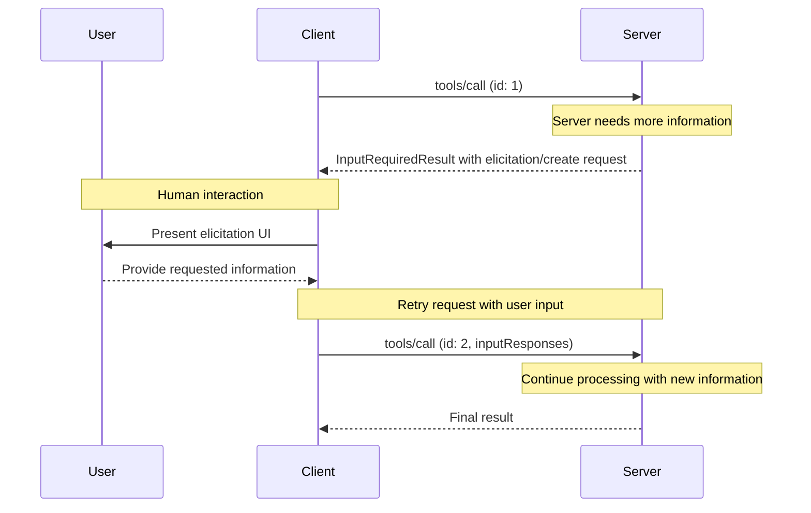

<Info>
  本页是社区维护的**非官方**中文译文，不代表 MCP 官方。原文：Model Context Protocol 项目的[英文页面](https://modelcontextprotocol.io/docs/2026-07-28/learn/client-concepts)（上游提交 `ac00313f`），© Model Context Protocol a Series of LF Projects, LLC.，按 [CC-BY-4.0](https://creativecommons.org/licenses/by/4.0/) 授权。本页由原文翻译成中文，并按同一许可发布。如有出入，以英文原文为准。
</Info>

MCP 客户端由宿主应用创建，用来与特定的 MCP 服务器通信。宿主应用（比如 Claude.ai 或某个 IDE）负责整体的用户体验，并协调多个客户端。每个客户端只负责与一个服务器的直接通信。

分清这两者很重要：*宿主*是用户直接使用的应用，而*客户端*是协议层面的组件，负责建立与服务器的连接。

<a id="core-client-features" />
## 客户端核心功能

客户端除了使用服务器提供的上下文，也可以向服务器提供功能，比如[征询](/specification/2026-07-28/client/elicitation)。借助这些功能，服务器开发者可以构建更丰富的交互。

<a id="elicitation" />
### 征询

征询让服务器可以在交互过程中向用户索取特定信息，使工作流更灵活、响应更及时。例如，一个预订旅行的服务器在最终确认预订前，可能会询问用户偏好的机上座位、房型，或者联系电话。

<a id="overview" />
#### 概述

征询为服务器提供了一种按需收集必要信息的结构化方式。服务器不必一开始就要求提供全部信息，也不必在缺少数据时直接失败，而是可以暂停当前操作，向用户索取特定输入。这样的交互更灵活：服务器会根据用户的需要调整，而不是按死板的固定模式走。

征询支持两种模式：

- **表单模式**：服务器请客户端向用户收集结构化数据。请求中带有一个 schema，客户端据此生成输入表单，并校验用户的回答。
- **URL 模式**：服务器提供一个 URL 让用户打开。交互在带外进行，数据从不经过客户端，因此这种模式适合输入凭据、第三方 OAuth 授权这类敏感流程。

征询遵循[多轮往返请求](/specification/2026-07-28/basic/patterns/mrtr)（MRTR）模式。服务器在处理 `tools/call` 这类请求时如果需要用户输入，就返回一个 `InputRequiredResult`，其 `inputRequests` 字段里带着一个或多个 `elicitation/create` 请求。客户端收集好输入后重试原请求，附上收集到的 `inputResponses`，并把服务器给出的 `requestState`（如果有）原样带回。

客户端在每个请求的 `elicitation` 能力里声明自己支持哪些模式，服务器不得使用声明之外的模式。空对象（`{}`）表示只支持表单模式，`{ "form": {}, "url": {} }` 则表示两种都支持。

**征询流程**：



这个流程实现了动态的信息收集：服务器在需要时索取特定数据，用户通过合适的界面提供信息，服务器再用新拿到的上下文完成重试的请求。

**征询示例**：

下面的消息接着[旅行规划场景](/zh/docs/2026-07-28/learn/server-concepts#the-complete-flow)往下讲。客户端调用 `bookVacation` 工具：

```json
{
  "jsonrpc": "2.0",
  "id": 1,
  "method": "tools/call",
  "params": {
    "name": "bookVacation",
    "arguments": {
      "outboundFlight": "EX101",
      "returnFlight": "EX102",
      "hotelId": "beachfront-hotel"
    },
    "_meta": {
      "io.modelcontextprotocol/protocolVersion": "2026-07-28",
      "io.modelcontextprotocol/clientInfo": {
        "name": "example-client",
        "version": "1.0.0"
      },
      "io.modelcontextprotocol/clientCapabilities": {
        "elicitation": {}
      }
    }
  }
}
```

服务器需要用户确认这次预订，所以返回一个 `InputRequiredResult`。其中 `resultType` 为 `"input_required"`，表示客户端必须先提供额外输入，服务器才能完成请求：

```json
{
  "jsonrpc": "2.0",
  "id": 1,
  "result": {
    "resultType": "input_required",
    "inputRequests": {
      "bookingConfirmation": {
        "method": "elicitation/create",
        "params": {
          "mode": "form",
          "message": "Please confirm your Barcelona vacation booking: flights June 15-22, beachfront hotel, total $3,000.",
          "requestedSchema": {
            "type": "object",
            "properties": {
              "confirmBooking": {
                "type": "boolean",
                "description": "Confirm the booking (Flights + Hotel = $3,000)"
              },
              "seatPreference": {
                "type": "string",
                "enum": ["window", "aisle", "no preference"],
                "description": "Preferred seat type for flights"
              },
              "roomType": {
                "type": "string",
                "enum": ["sea view", "city view", "garden view"],
                "description": "Preferred room type at hotel"
              },
              "travelInsurance": {
                "type": "boolean",
                "default": false,
                "description": "Add travel insurance ($150)"
              }
            },
            "required": ["confirmBooking"]
          }
        }
      }
    },
    "requestState": "opaque-string-from-the-server",
    "_meta": {
      "io.modelcontextprotocol/serverInfo": {
        "name": "travel-server",
        "version": "1.0.0"
      }
    }
  }
}
```

用户填完表单后，客户端用一个新的 `id` 重试调用。重试请求把用户的回答放在 `inputResponses` 里，键名与服务器请求中的一样，都是 `bookingConfirmation`，同时原样带上结果里的 `requestState` 值：

```json
{
  "jsonrpc": "2.0",
  "id": 2,
  "method": "tools/call",
  "params": {
    "name": "bookVacation",
    "arguments": {
      "outboundFlight": "EX101",
      "returnFlight": "EX102",
      "hotelId": "beachfront-hotel"
    },
    "inputResponses": {
      "bookingConfirmation": {
        "action": "accept",
        "content": {
          "confirmBooking": true,
          "seatPreference": "window",
          "roomType": "sea view",
          "travelInsurance": false
        }
      }
    },
    "requestState": "opaque-string-from-the-server",
    "_meta": {
      "io.modelcontextprotocol/protocolVersion": "2026-07-28",
      "io.modelcontextprotocol/clientInfo": {
        "name": "example-client",
        "version": "1.0.0"
      },
      "io.modelcontextprotocol/clientCapabilities": {
        "elicitation": {}
      }
    }
  }
}
```

服务器完成预订，返回一个 `CallToolResult`。其中 `resultType` 为 `"complete"`，表示请求已成功完成：

```json
{
  "jsonrpc": "2.0",
  "id": 2,
  "result": {
    "resultType": "complete",
    "content": [
      {
        "type": "text",
        "text": "Booked flights EX101 and EX102 and a sea view room at the beachfront hotel."
      }
    ],
    "_meta": {
      "io.modelcontextprotocol/serverInfo": {
        "name": "travel-server",
        "version": "1.0.0"
      }
    }
  }
}
```

<a id="example-holiday-booking-approval" />
#### 示例：度假预订确认

旅行预订服务器的最终确认环节，很能体现征询的作用。用户选好了理想的巴塞罗那度假套餐后，服务器在继续之前，需要拿到用户的最终确认，并补齐缺少的信息。

服务器发出一个结构化的征询请求来确认预订，里面有行程摘要（6 月 15 日至 22 日往返巴塞罗那的航班、海滨酒店、共计 3,000 美元），以及填写其他偏好的字段，比如选座、房型或旅行保险选项。

随着预订推进，服务器还会征询完成预订所需的联系信息，比如订机票需要的旅客信息、对酒店的特殊要求，或者紧急联系人信息。

<a id="user-interaction-model" />
#### 用户交互模型

征询交互的设计目标是清晰、有上下文，并尊重用户的自主权：

**请求的展示**：客户端展示征询请求时，要清楚交代是哪个服务器在问、为什么需要这些信息、会怎么使用。请求消息说明用途，schema 则提供结构和校验。

**回应方式**：用户可以通过合适的界面控件（文本框、下拉框、复选框）提供所需信息，也可以明确拒绝提供，或者不做选择直接关掉请求。这三种分别对应 `accept`、`decline` 和 `cancel` 动作。客户端在把回答交给服务器之前，会按提供的 schema 校验。

**URL 的处理**：在 URL 模式下，客户端会显示完整的 URL，取得用户明确同意后才打开，绝不自动访问该 URL。客户端只知道用户是否同意，交互本身只发生在用户和目标网站之间。

**隐私考虑**：服务器不得用表单模式索取密码、API 密钥、访问令牌或支付凭据这类敏感信息。这些交互应该走 URL 模式，让数据在带外传递，从不经过客户端或 LLM 上下文。客户端会对可疑请求发出警告，并让用户在发送前检查表单数据。

<a id="deprecated-features" />
## 已弃用的功能

<Warning>

从协议版本 `2026-07-28` 起，根目录和采样已[弃用](/specification/2026-07-28/deprecated)，并计划移除。新的实现应改用以下替代方案：

- **根目录**：通过工具参数、资源 URI 或服务器配置传递目录或文件。
- **采样**：直接对接 LLM 提供商的 API。对于通过客户端请求模型补全这件事，协议没有定义替代机制。

</Warning>
